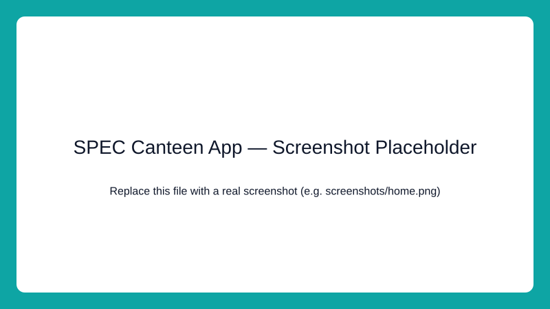

# 🍽️ SPEC Canteen App

[](LICENSE) [](https://bite-order-spicy.lovable.app)

A digital canteen ordering solution designed to make food ordering more convenient for students and staff at St. Peter's Engineering College (SPEC).

The goal is to simplify the campus canteen experience by making menu browsing and food ordering easier, reducing unnecessary waiting, and creating a smoother experience for students and canteen staff.

## 📌 About the Project

The SPEC Canteen App is a college-focused project that aims to bring the traditional canteen experience online. Instead of relying entirely on manual ordering, students can use a digital interface to browse the menu, select items, and place orders efficiently.

This project is being developed with a focus on usability, simplicity, and the needs of a college campus.

## ✨ Live Demo / Website

- Project website: https://bite-order-spicy.lovable.app
- Demo badge (top) links to the live site.

## 📷 Screenshot

[](https://bite-order-spicy.lovable.app)

Add a real screenshot under `screenshots/home.png` or replace `screenshots/home.svg` with a production screenshot.

## 🎯 Project Objectives

- Reduce the inconvenience of traditional canteen ordering.
- Make food information easier to access.
- Improve the overall ordering experience for students and staff.
- Explore how technology can solve everyday problems within a college campus.
- Build a foundation that can be extended with additional canteen management features.

## 🛠️ Tech Stack

The technologies used in this project depend on the current implementation.

- Frontend: Vite + React + TypeScript
- Backend: Add your backend framework or technologies here.
- Database: Add your database here.
- Development Tools: Git and GitHub.

> Note: A `homepage` field is included in `package.json` and points to the live demo so relevant tooling can reference the site.

## 🚀 Getting Started

Follow these steps to get a local copy of the project.

### Prerequisites

Install the tools required by the project's technology stack.

### Installation

1. Clone the repository

```bash
git clone https://github.com/Adityasantosh7/speccanteenapp.git
```

2. Navigate to the project directory

```bash
cd speccanteenapp
```

3. Install dependencies

```bash
npm install
```

4. Start the application

```bash
npm run dev
```

## 📦 Deploying to GitHub Pages (optional)

This project uses Vite. To deploy to GitHub Pages you can:

1. Add a build script (already present: `npm run build`).
2. Install `gh-pages` (optional) and add a deploy script, or configure GitHub Actions to build and publish the `dist/` folder to the `gh-pages` branch.

Example using `gh-pages`:

```bash
npm install --save-dev gh-pages
```

Add to `package.json` scripts:

```json
"predeploy": "npm run build",
"deploy": "gh-pages -d dist"
```

Then run:

```bash
npm run deploy
```

Alternatively, create a GitHub Actions workflow that builds and publishes the `dist/` folder to the `gh-pages` branch.

## 🔮 Future Improvements

Potential improvements for the project include:

- Online payment integration.
- Live order status and tracking.
- Order history and token generation.
- Menu availability updates.
- An admin dashboard for managing food items and orders.
- Notifications when an order is ready.
- Feedback and ratings for food items.

## 🎓 Project Context

- Institution: St. Peter's Engineering College
- Department: Computer Science and Engineering
- Project: SPEC Canteen App

## 🤝 Contributions

Suggestions and improvements are welcome. You can fork the repository, create a feature branch, and submit a pull request.

## 📄 License

This project is licensed under the MIT License. See the [LICENSE](LICENSE) file for details.

---

Developed as a campus-focused project for St. Peter's Engineering College.
